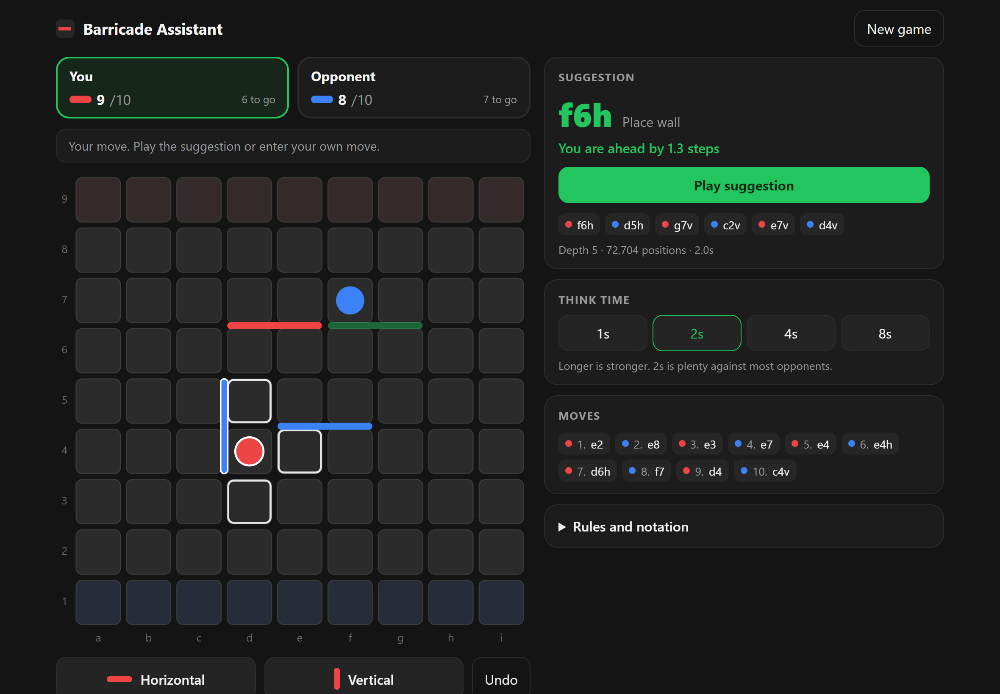
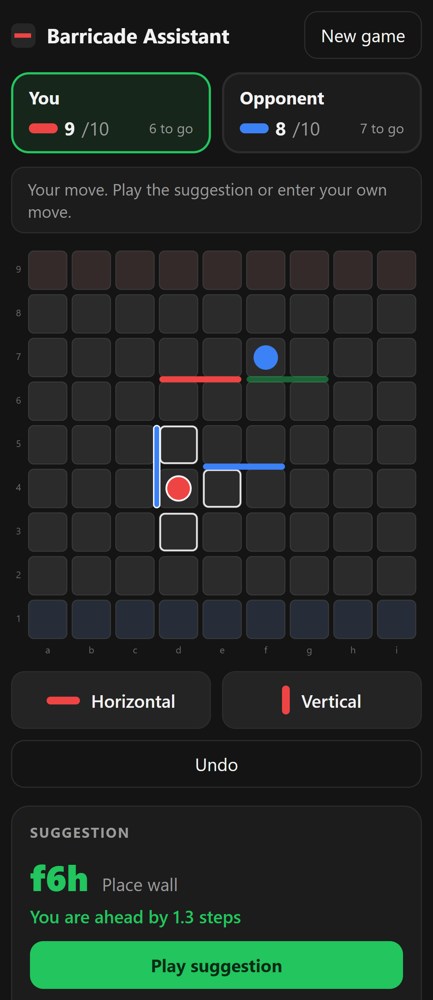

# Barricade Assistant

A move-suggestion engine for **Barricade**, the 9×9 wall-and-race board game.
Mirror a game you are playing elsewhere move by move, and on every turn the
engine searches the position and tells you the strongest move to play.

Runs entirely in the browser: no server, no API keys, no LLM. Works offline once loaded.

**Live demo:** https://areeb-ali.github.io/Barricade-Assistant/

<p align="center">
  
  &nbsp;
  
</p>

## Features

- **Game-tree search engine**: iterative-deepening negamax with alpha-beta pruning,
  a Zobrist-hashed transposition table and history move ordering, running in a
  Web Worker so the UI stays responsive.
- **Shortest-path evaluation**: positions are scored by the race between both
  players' shortest routes to goal, walls in hand, and exact race detection
  once a player has no walls left.
- **Full rules**: straight jumps, diagonal side-steps, wall overlap and crossing
  checks, and the "never fully block a player" rule.
- **Learns from losses**: every finished game is saved. Lost games are replayed in the
  background with a much deeper search; wherever a clearly better move existed, it is stored
  as a *lesson* (also for the mirror-image position) and played the next time that position
  comes up.
- **Auto-play**: the engine plays its suggestion for you, so you only enter the
  opponent's moves. If you played something different, one tap lets you enter your actual move.
- **Mobile-first UI**: tap a square to move, or pick Horizontal / Vertical and tap a gap
  to place a wall (tap twice on touch screens to confirm). Includes undo, the
  best line of play, configurable think time, and auto-save in local storage.

## How to use

1. Open the app, choose your colour (red or blue) and pick who moves first.
2. On **your** turn the engine thinks for a moment and, with **Auto-play** on (the default),
   plays the best move for you. It is shown above the board and marked in green. Copy it into your game.
3. On the **opponent's** turn, enter what they played: tap the square their pawn moved to,
   or choose Horizontal / Vertical and tap where their wall went.
4. Played something other than the suggestion? Tap **I played something else** and enter
   your actual move. Auto-play continues from the next turn.
5. Made a mistake? Press **Undo**.

On a laptop you can use the keyboard: <kbd>H</kbd> horizontal wall, <kbd>V</kbd> vertical wall,
<kbd>Esc</kbd> cancel, <kbd>Ctrl</kbd>+<kbd>Z</kbd> undo. In wall mode, clicking the middle of a
highlighted square still moves the pawn.

Turn Auto-play off in **Settings** to confirm each of your moves with **Play suggestion** instead.

You always play from the bottom (racing up) and the opponent from the top (racing down),
in whichever colours you chose.

## Game history and lessons

- Finished games appear under **Your games** with the result.
- Starting a new game while one is in progress counts as the **opponent leaving** (a win).
- Each loss is studied automatically (about 6 seconds per move you made). Progress is shown
  in the panel, and studying resumes if you close the page midway.
- Everything is stored in your browser's local storage on that device. Use **Export backup**
  to save it as a file and **Import backup** to load it on another device or browser.

## Getting started

Requires Node.js 18 or later.

```bash
npm install
npm run dev       # start the dev server
npm test          # run the engine test suite
npm run build     # type-check and build to dist/
npm run match -- linear50 default 40 100   # engine-vs-engine tuning match
```

## Deploying

The app is a static Vite build with relative asset paths, so any static host works.

**GitHub Pages:** in *Settings → Pages*, set *Source* to **GitHub Actions**. The
[`deploy.yml`](.github/workflows/deploy.yml) workflow tests, builds and publishes on every push to `main`.

**Netlify:** choose *Add new site → Import an existing project* and pick this repository.
Build settings are read from `netlify.toml` (build command `npm run build`, publish
directory `dist`). Every push to `main` redeploys.

**Vercel:** import the repository at [vercel.com/new](https://vercel.com/new). The Vite
preset is detected automatically.

## Project structure

```
src/
  engine/
    rules.ts       board representation, move generation, legality, path finding
    search.ts      alpha-beta search, evaluation, transposition table
    notation.ts    move names (e2, d4h, …)
    worker.ts      Web Worker entry point for the search
  hooks/
    useEngine.ts   runs and cancels searches as the position changes
  components/
    Board.tsx      SVG board with pawn and wall input
  App.tsx          game state, panels, setup screen
```

## Notation

Squares are named `a1`–`i9`: files `a`–`i` from left to right, ranks `1`–`9` from
the bottom (your side) to the top. A wall is named by the square at the lower-left
of the 2×2 block it splits, followed by `h` (horizontal) or `v` (vertical). For
example, `e1h` is a horizontal wall just above squares `e1` and `f1`.

## License

[MIT](LICENSE)
